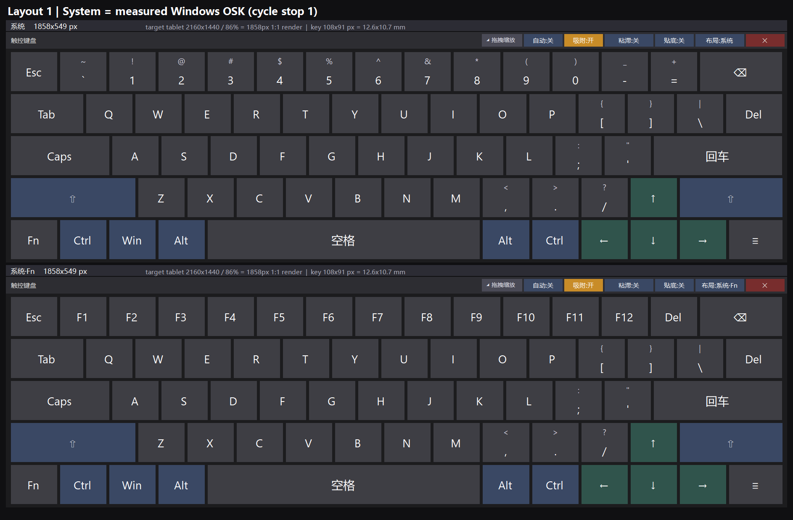
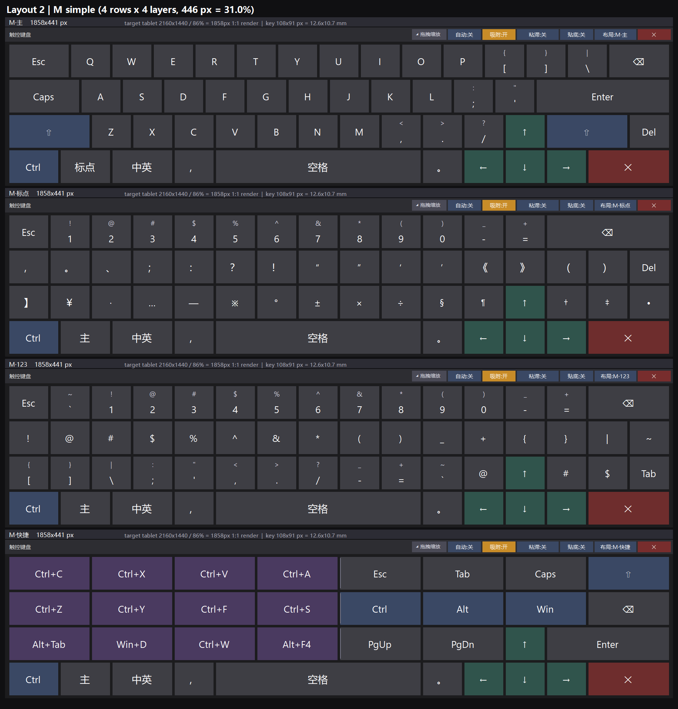
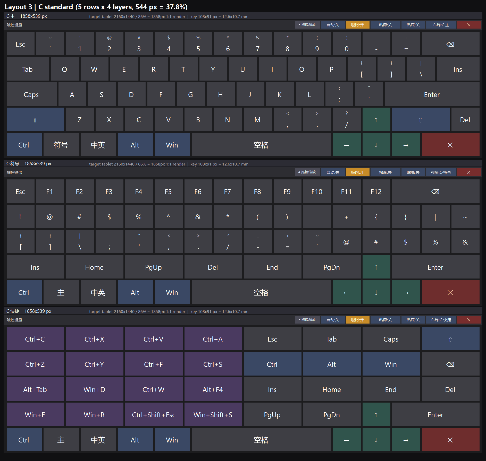

# 触控键盘类

> 解决"点输入框没反应、触摸键盘叫不出来"：系统 `TabTip.exe` / `osk.exe` 被精简掉时，
> 用自研键盘顶上，并把系统的触摸键盘入口接管过去。

本大类包含 **1 个实现 + 2 个配套工具 + 2 份资料**。

| 子目录 / 文件 | 角色 | 需要权限 |
|---|---|---|
| [`TouchKeyboard/`](TouchKeyboard/) | **自研触控键盘本体**（C# / WinForms，单文件 exe） | 普通用户 |
| [`OskRedirect/`](OskRedirect/README.md) | 把系统「触摸键盘」入口（任务栏按钮 / `osk.exe` / `TabTip.exe`）重定向到自研键盘 | 管理员 |
| [`OskCheck/`](OskCheck/CheckOsk.ps1) | 诊断：系统自带屏幕键盘到底缺什么、能不能真正启动 | 普通用户 |
| [`NB_TouchKeyboard_资料/`](NB_TouchKeyboard_资料/README.md) | 第三方同类方案（NB_TouchKeyboard，GPL-3.0）的文字说明，不含其二进制 | — |
| [第三方屏幕键盘方案调研.md](第三方屏幕键盘方案调研.md) | 8 个第三方方案的横向调研 + 中文输入怎么解决 + 通用限制 | — |

## 布局预览（1:1 实拍）

三套布局由顶栏「布局」按钮按**族**循环：**系统 → M → C → 系统**；族内用键盘上的 `go:` 键切层。
下面三张图是按目标平板 **2160×1440、86% 屏宽（= 1858 px）** 的真实渲染尺寸抓取的，键 **108×91 px = 12.6×10.7 mm**。

### 1｜系统 —— 复刻本机 Windows「屏幕键盘」实测布局（5 行 · 2 层 · 549 px）



把 `osk.exe` 的实测网格搬进布局：行宽按实测（15.63/15.63/15.73/15.73/15.84u）、**双字键帽**与屏幕键盘一致
（`~` 在 `` ` `` 上、`!` 在 `1` 上、`&` 在 `7` 上…）、`↑` 在 `↓` 正上方。`Fn` 键切到 `[系统·Fn]`（数字行变 F1–F12）。

> 为在"每行各自撑满宽度"的渲染下保持各行等宽与 ↑/↓ 同列，字符键一律保持实测 1u，仅微调 4 个功能键
> （⌫ 1.63→1.73、Del 1.10→1.20、空格 5.76→5.59、≡ 1.08→1.14）。
> 右侧 3×5 导航簇未复刻：本 app 每行是一条流、做不了多列块，且其中 7 个键是 OSK 自身的 UI 控件。

### 2｜M 简化版（4 行 · 4 层 · 441 px = 30.6% 屏高）



`主`（字母区 ANSI 阶梯 1.5/1.75/2.0 + 倒 T 方向键 + 底行空格两侧「，。」）/
`标点`（数字行置顶）/ `123` / `快捷`（左半组合键、右半功能键）。

### 3｜C 标准版（5 行 · 4 层 · 539 px = 37.4% 屏高）



`主`（ANSI 主键区原样，数字行常驻）/ `符号`（F 功能键行置顶）/ `快捷`（16 个组合键 + 16 个功能键，左/右分区带分隔线）。

> 三套布局共享同一套字母阶梯、倒 T 方向键与底部骨架行；每层只保留一个退格键，`Esc` 固定在常规层最左。
> 配色：修饰键蓝灰、**方向键墨绿**、**组合键紫**、关闭键红。全部行宽严格相等（M/C 为 16u），四周像素对齐。

## 推荐使用顺序

1. **先诊断**：跑 `OskCheck\检查屏幕键盘.cmd`，确认是 `TabTip.exe` 文件缺失、还是 `osk.exe` 起了但 UIAccess 链断了。
   `osk.exe` 能用的机器没必要上自研键盘。
2. **再部署键盘**：按 [`TouchKeyboard/`](TouchKeyboard/) 的构建说明编译出 `TouchKeyboard.exe`，
   放到固定目录（仓库脚本默认按 `C:\Tools\TouchKeyboard\` 工作），
   跑 `开机自启-安装.cmd` 让它以用户身份常驻托盘。
3. **要接管系统入口时才装** `OskRedirect`：它改注册表（`CLSID\{054AAE20-…}\LocalServer32` + `osk.exe`/`TabTip.exe` 的 IFEO），
   **不碰任何系统文件**，可完整卸载。装之前建议先读它 README 的第三节——**COM 那条路在精简系统上补不起来**，别去踩。

## TouchKeyboard 关键行为

- **自动呼出**：焦点进输入框自动弹出（Win32 Caret 探测 → 窗口类名白名单 → UI Automation 兜底三级判定）；
  手动关闭后进入抑制态，再点一次输入框才恢复自动弹出。
- **贴底占位**：向系统登记为 AppBar，其他窗口与最大化窗口自动让位；顶部可拖拽调整贴底高度；
  **关闭键盘即归还桌面工作区**；旋转 / 分辨率变化后自动重算。
- **可视化调整**：顶栏「◢ 拖拽缩放」手柄改尺寸（拖拽期间只画预览框，松手才应用一次），结束后吸附屏幕边缘。
- **布局热加载**：外部 `layouts.ini`，点键盘上的「布局」即重新读取；内置四套（系统 / 默认 / 带Fn行 / 简洁），
  均以 Windows 自带 26 键排布为蓝本，切换时字母区位置不变。
- **实体键盘实时高亮**（全局键盘钩子）、**粘滞键**（关 / 单次）。
- 托盘常驻、可选开机自启；不抢焦点（`WS_EX_NOACTIVATE`）、不进任务栏 / Alt+Tab（`WS_EX_TOOLWINDOW`）。
- **单实例 = 开关**：键盘已在运行时再次启动它，不弹「已在运行」，而是让运行中的实例**显示 ↔ 隐藏**
  （命名事件 `TouchKeyboard_ToggleRequest_v2`）——这是系统触摸键盘入口能把它当目标拉起的关键。

## 文件构成（`TouchKeyboard/`）

| 文件 | 说明 |
|---|---|
| `TouchKeyboard.v2.cs` | **当前源码，唯一真源**（约 2170 行） |
| `TouchKeyboard.cs` | 早期版本源码（硬编码 5 排布局、无托盘 / 自动呼出 / 贴底），保留作参考 |
| `SetAutostart.ps1` | 开机自启安装 / 卸载 / 状态：往启动文件夹写 `TouchKeyboard.vbs`（以 `-hidden` 驻留托盘） |
| `开机自启-安装.cmd` / `开机自启-卸载.cmd` | 上面脚本的一键入口，自动提权 |

## 构建

用 PowerShell 内联编译，**不需要 Visual Studio**：

```powershell
$code = Get-Content '.\触控键盘\TouchKeyboard\TouchKeyboard.v2.cs' -Raw -Encoding UTF8
Add-Type -TypeDefinition $code -Language CSharp `
  -OutputAssembly "$env:TEMP\TouchKeyboard.exe" -OutputType WindowsApplication `
  -ReferencedAssemblies System.Windows.Forms,System.Drawing,UIAutomationClient,UIAutomationTypes
```

- ⚠️ **必须用 Windows PowerShell 5.1**（`powershell.exe`）：PowerShell 7 的 `Add-Type` 不支持
  `-OutputType WindowsApplication`，会报"当前不支持程序集类型 'WindowsApplication'"。
- 源码把所有警告当错误（未使用的字段 / 变量都会导致编译失败）；本仓库在 5.1 下实测零警告通过。
- 目标 exe 被占用时无法覆盖：编译前先退出正在运行的键盘。

## 运行时参数与配置文件

命令行参数（源码实际支持）：

| 参数 | 作用 |
|---|---|
| `-show` | 启动即显示 |
| `-hidden` | 启动即驻留托盘（开机自启用的就是这个） |
| `-dock` | 启动即贴底 |
| `-nosnap` | 关闭边缘吸附 |
| `-auto` | 开启自动呼出（覆盖 ini 里的 `auto`） |
| `-debug` | 写 `kb-debug.log`，排查自动呼出 / 贴底定位问题 |
| `-comserve` | 额外注册 `CLSID_UIHostNoLaunch` 的 COM 类工厂（**默认关闭**，原因见 [`OskRedirect/README.md`](OskRedirect/README.md) 第三节） |
| `-embedding` | COM LocalServer32 拉起时的行为：先隐藏等 `Toggle()`，1.2 秒没等到就自己显示 |

> 上游 README 列出过 `-noauto`，但源码只读 `-auto`，**`-noauto` 目前没有任何分支**（传了等于没传）。

生成在同目录的文件：`TouchKeyboard.ini`（窗口位置 / 尺寸 / 各开关状态）、`layouts.ini`（布局）、
`kb-launch.log`（每次启动记一行：命令行 / 账户 / 会话号 / 是否第一实例）、
`kb-debug.log`（`-debug`）、`kb-crash.log`（未处理异常落盘）。

`layouts.ini` 格式：`Row: 键名[*宽度] 键名[*宽度] ...`，键名支持单字符、`esc tab caps enter bk del ins
home end pgup pgdn shift ctrl alt win space zh close left up down right f1..f12`。文件头部注释有完整说明。

## 已知限制

- 无法向"以管理员身份运行"的窗口输入（Windows UIPI 完整性级别限制）；登录界面 / UAC 安全桌面不可用。
- **多指同时操作**（一根手指按住修饰键、另一根指点字母）在部分环境不可用：源码里的 `WM_TOUCH` 多点通路
  已实现但 `touchRoutingEnabled` 恒为 `false`、且从未调用 `RegisterTouchWindow`，即**默认关闭**（真机未充分验证）。
- 极少数全自绘输入框（网页富文本编辑区）可能不触发自动呼出，可从托盘手动呼出。
- **贴底状态下请通过键盘上的「贴底」开关或托盘菜单退出**：强杀进程可能让 Windows 残留 AppBar 占位
  （桌面工作区变小 / 最大化窗口变矮），重开再正常关闭、或重启资源管理器即可恢复。
- 退出走托盘菜单，避免留下"幽灵托盘图标"。
- 被系统触摸键盘服务以 **SYSTEM 身份**拉起时（`OskRedirect` 的做法），键盘能显示能输入，
  但托盘右键菜单可能点不动（UIPI）；用 `✕` 关掉后从快捷方式重启即可回到用户身份。

机器相关的缺失组件与实测结论见顶层 [机器环境.md](../机器环境.md)，
完整限制清单见顶层 [README.md](../README.md) 的「已知限制」。
